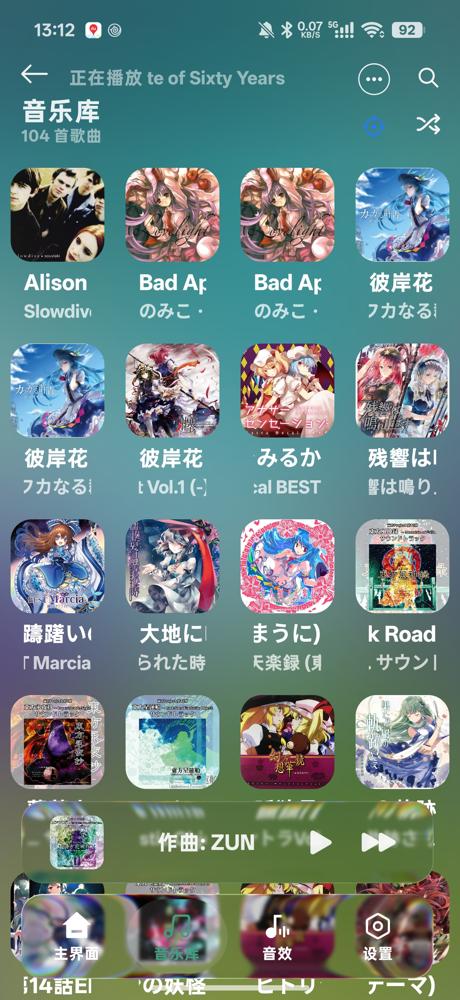
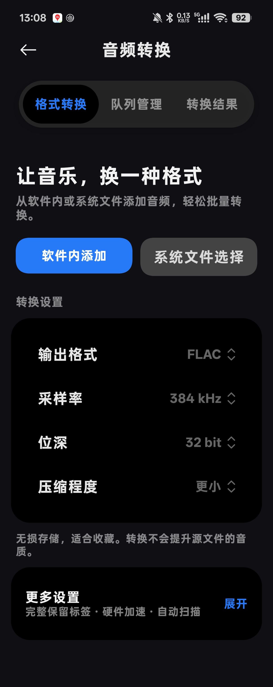
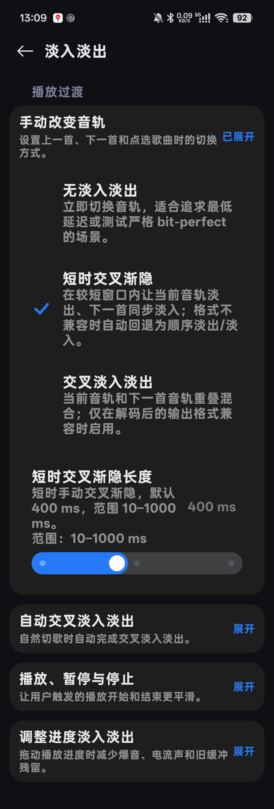

# RawS Music

**为本地音乐、细腻歌词与可调音频体验而设计的 Android 播放器。**

**简体中文** · [English](README_EN.md) · [日本語](README_JA.md) · [한국어](README_KO.md)

[下载稳定版](https://github.com/QFDY-GZC/RawS-Music/releases/latest) · [更新日志](docs/release-notes-1.0.13-release.md) · [反馈问题](https://github.com/QFDY-GZC/RawS-Music/issues) · [截图画廊](docs/screenshots/README.md)

## 音乐，由你掌控

RawS Music 以本地曲库为中心，把多维度分类、带注音的动态歌词、音频输出与 DSP 调节放在同一个应用中。可以用简洁的列表浏览收藏，也可以开启封面取色、流光背景与液态玻璃，打造自己的播放界面。

截图来自实际应用，使用了自定义字体与外观参数；完整设置长截图见[画廊](docs/screenshots/README.md)。封面及音乐内容的权利属于各自权利人。

## 核心功能

| 方向 | 能做什么 |
| :-- | :-- |
| 曲库管理 | 按歌曲、专辑、艺术家、作曲家、流派、年份与文件夹浏览；文件夹层级、播放列表、搜索、排序、多种列表与网格布局、播放统计。 |
| 歌词体验 | 逐行与逐字歌词、翻译、罗马音、日语注音与日文字形；切句弹簧动画、手势缩放、内嵌歌词读取、歌词搜索预览与批量匹配、Lyrico 插件接入。 |
| 播放过渡 | 无缝播放、手动短时交叉渐隐、自动智能交叉淡入淡出；结合歌词与音频能量调整交接，支持临时取消当前片段的自动交接。 |
| 音频输出 | AudioTrack、AAudio、OpenSL ES 与 Direct / Hi-Res 路径；发行 APK 提供 USB DAC 独占、PCM、DoP 与 Native DSD 等设备适配选项。 |
| 音频效果 | 均衡器、空间与动态处理、混响场景及参数、响度标准化 ReplayGain、DVC、重采样、倍速与变调选项。 |
| DSD / SACD | DSD 音频与 SACD-ISO 读取、曲目解析及 DST 解码；格式转换提供 DSF 与 SACD-ISO 目标。 |
| 格式转换 | 批量队列、单曲参数、取消与结果管理；多种无损及有损格式，支持元数据、封面与歌词迁移。 |
| 系统歌词 | 超级岛歌词与封面取色、Lyricon 桥接、车载相关歌词/媒体信息传递；依赖 ROM、权限与接收端能力。 |
| 可选 AI 工具 | 人声分离与歌词对齐相关工具；按需准备模型或插件，处理能力与资源需求取决于所选方案。 |
| 外观与工具 | Miuix 风格界面、亮暗主题、液态玻璃、封面取色与流光、自定义图片/视频背景、字体与歌词布局设置、播放界面常亮、WebDAV、歌曲分析与歌词视频工具。 |

详细格式、适用条件与功能边界见[功能说明](docs/FEATURES.md)。

## 安装与开始使用

1. 从 [Releases](https://github.com/QFDY-GZC/RawS-Music/releases/latest) 下载稳定 APK。当前发行包适用于 **Android 7.0 / API 24 及以上、arm64-v8a** 设备。
2. 授予音频或所选文件夹的访问权限，扫描本地音乐；也可以按需配置 WebDAV。
3. 在“播放与输出”选择音频路径，在“音频效果”和“外观主题”调整听感与界面。
4. 使用超级岛等系统集成功能前，按应用提示配置 ROM 所需权限；部分适配需要 Shizuku。它们不是所有 Android 系统通用的能力。

高采样率、Native DSD 与 USB 硬件音量取决于设备和 DAC。严格 bit-perfect 模式会绕过可能改变音频数据的处理；转换格式、提高采样率或位深不会提升源文件原本的音质。AI 工具可能需要额外下载模型，效果和速度受设备限制。

## 文档导航

| 文档 | 内容 |
| :-- | :-- |
| [功能与格式](docs/FEATURES.md) | 播放、歌词、转换与兼容性说明 |
| [构建说明](docs/BUILDING.md) | SDK / JDK / NDK 与源码公开范围 |
| [依赖与开源致谢](docs/DEPENDENCIES.md) | 实际依赖、用途、许可证与审计说明 |
| [截图画廊](docs/screenshots/README.md) | 主界面、曲库、输出、转换与外观 |
| [贡献指南](CONTRIBUTING.md) | 反馈问题、提交修改与提供日志 |
| [二次修改与再分发](FORK_POLICY.md) | 独立维护声明、许可义务与建议 |

## 项目标签与统计

`Android` / `Kotlin` / `Jetpack Compose` 描述平台与技术栈；`local music` / `lyrics` 描述主要使用场景；`DSD` / `SACD` / `DSP` 描述音频能力，具体支持条件见功能说明。

| 徽章 | 含义 |
| :-- | :-- |
| Release | GitHub 上最新非预发布版本，点击可下载。 |
| Downloads | GitHub Release 资源累计下载次数，不是安装人数。 |
| Stars / Issues | 仓库关注与待处理反馈，不是性能或质量评分。 |
| README views | 第三方图片计数器的请求统计，受缓存影响，不代表独立访客人数。 |
| Android / ABI | 当前发行包的最低系统要求和处理器架构。 |
| License | 本仓库主许可证；第三方组件使用各自许可证。 |

### Star 增长

徽章、访问计数及趋势图由第三方服务生成，服务不可用时不影响应用使用。

## 开源范围与二改声明

本仓库主项目采用 [Apache-2.0](LICENSE)，第三方组件保留各自许可。**完整 USB 独占播放核心目前未包含在公开仓库中**；发行 APK 与公开源码的可构建范围有区别，请先阅读[构建说明](docs/BUILDING.md)。

**未经原维护者明确确认，二次修改、Fork、第三方打包与再发布项目均独立维护，与 RawS Music 原项目及作者不存在官方隶属、合作、授权或背书关系。** 二改项目的修改、服务、支持与承诺由其维护者负责；保留出处表示代码来源，不表示官方认可。

再分发应遵守许可证：提供许可证副本，保留相关版权和 NOTICE 声明，在修改文件中显著说明改动，并遵守所包含第三方组件的许可。不得把来源说明用作冒充官方身份的依据。改名、使用独立包名/签名、提供自己的反馈入口是维护建议；本声明不增加与 Apache-2.0 冲突的限制。完整说明及声明模板见 [FORK_POLICY.md](FORK_POLICY.md)。

感谢所有贡献者，以及[依赖清单](docs/DEPENDENCIES.md)中的开源项目与素材作者。
