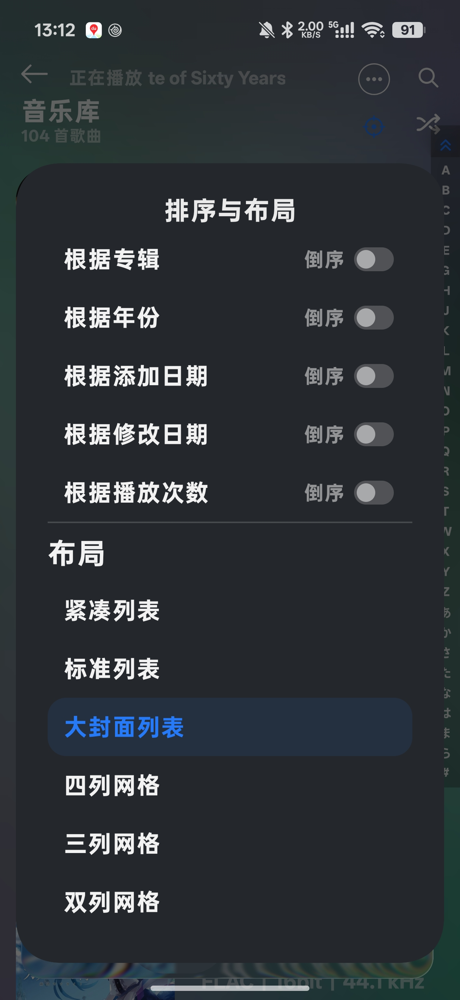
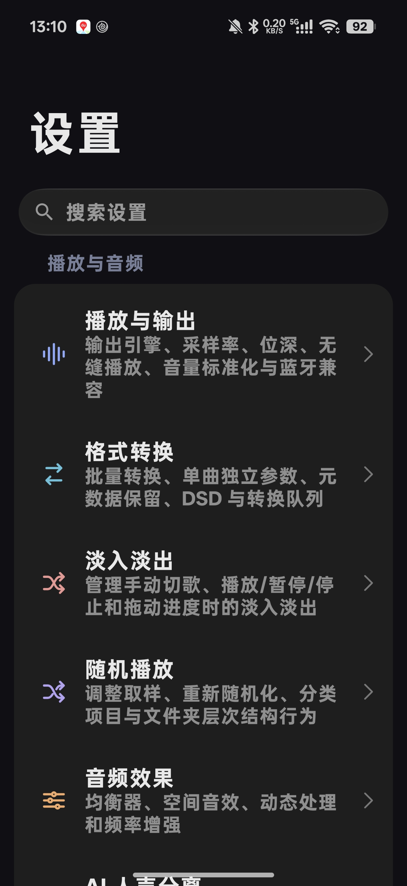
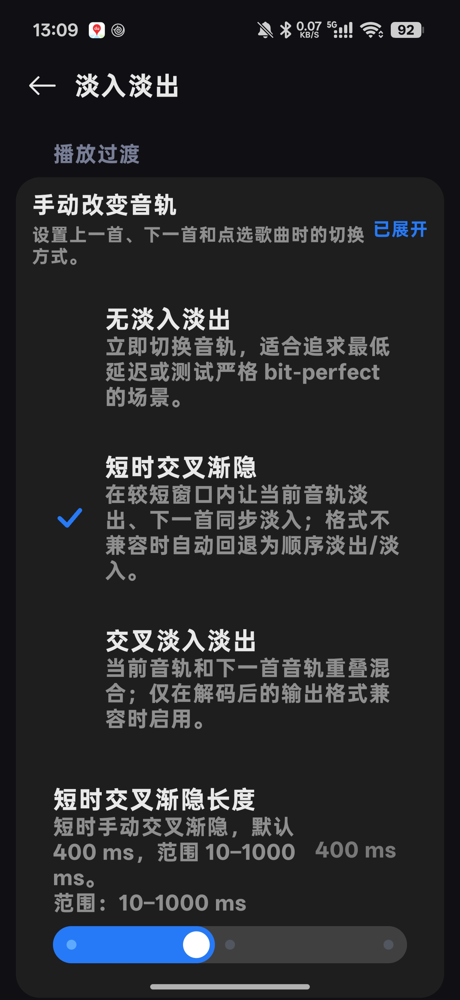
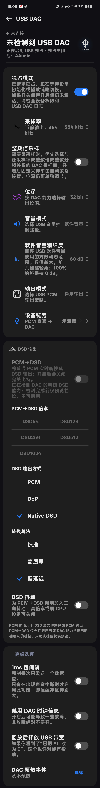

# 截图画廊 / Screenshots / スクリーンショット / 스크린샷

[简体中文](../../README.md) · [English](../../README_EN.md) · [日本語](../../README_JA.md) · [한국어](../../README_KO.md)

来自实际应用，拍摄于 2026-10-13。字体、字号、背景与布局使用了用户设置；图中断开的 DAC 状态只表示截图时未连接设备。点击图片或展开详情查看完整界面。长截图保留原图，首页仅展示较短的预览。

## 曲库 / Library

## 设置与转换 / Settings and conversion

主界面 / Home

播放与输出 / Playback and output

外观主题 / Appearance

USB DAC

界面展示不保证所有输出能力都适用于所有设备。完整 USB 独占核心不在当前公开仓库内，见[构建说明](../BUILDING.md)。

Album artwork and music belong to their respective rights holders. Screenshots illustrate the app with customized preferences, not a guarantee of hardware support. The complete USB exclusive core is currently outside the public source scope.
